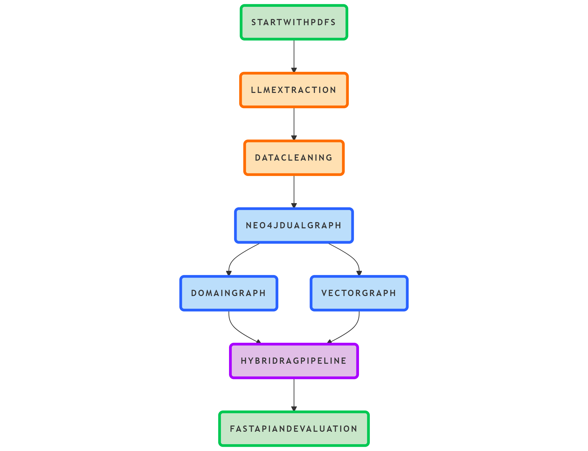
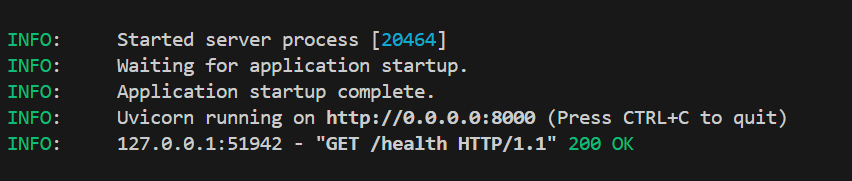
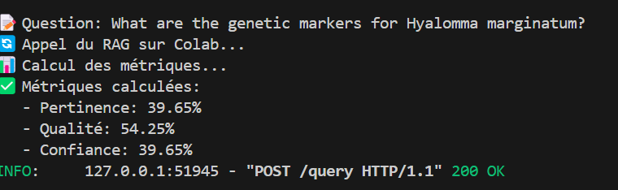

🦟 Hyalomma RAG System
======================

> **Hybrid Retrieval-Augmented Generation system for scientific literature analysis on *Hyalomma* ticks in Tunisia**

A production-ready **Hybrid RAG pipeline** combining **Neo4j knowledge graphs** and **vector-based semantic retrieval** to analyze and synthesize scientific literature on *Hyalomma* ticks and tick-borne diseases in Tunisia.

\
\
\

* * * * *

🌟 Key Features
---------------

-   **🔀 Hybrid RAG Architecture** -- Combines structured knowledge from a Neo4j domain graph with unstructured semantic retrieval via vector embeddings.

-   **⚡ Parallel Retrieval** -- Cypher queries and semantic vector searches run concurrently for fast (<2s) response times.

-   **📊 Multi-Metric Evaluation** -- Automated scoring for relevance, consistency, fluency, quality, and confidence.

-   **🌐 FastAPI Service Layer** -- REST API exposing RAG functionalities for seamless integration into the collaborative platform.

-   **📚 Automated ETL Pipeline** -- Converts scientific PDFs → Structured JSON → Neo4j graph database.

-   **🧠 Domain-Aware Prompting** -- Integrates knowledge graph facts with contextual scientific text during generation.

* * * * *

📊 Performance Results
----------------------

| Metric | Value |
| --- | --- |
| **Response Time** | < 2 seconds |
| **Confidence Score** | > 80% |
| **JSON Parsing Success** | 23 / 27 |
| **Articles Processed** | 27 |
| **Vector Chunks** | ≈ 500 |

* * * * *

🏗️ Architecture
----------------

### System Overview

### Dual Graph Design

**🧬 Domain Graph (Neo4j Property Graph)**\
Represents structured parasitological knowledge with relationships between key biological entities:

-   **Nodes:** `Article`, `Species`, `Location`, `Host`, `Disease`

-   **Relationships:** `STUDIES`, `TRANSMITS`, `PARASITIZES`, `FOUND_IN`, `CONDUCTED_IN`

-   **Properties:** Genetic markers, bioclimatic zones, host systems, publication metadata

**🔎 Vector Graph (Neo4j Vector Index)**\
Handles unstructured text retrieval:

-   Sentence-aware chunking (max 1000 tokens, overlap 100)

-   Embeddings: `all-MiniLM-L6-v2` (384D)

-   Cosine similarity search via Neo4j's native vector index

* * * * *

🚀 Quick Start
--------------

### Prerequisites

-   Python **3.10+**

-   Neo4j **5.0+** (with GDS plugin)

-   Ollama installed locally with the **Mistral** model

-   (Optional) GPU acceleration for embeddings

* * * * *

### Installation

`# Clone repository
git clone https://github.com/eya222/hyalomma-rag-system.git
cd hyalomma-rag-system

# Create virtual environment
python -m venv venv
source venv/bin/activate  # On Windows: venv\Scripts\activate

# Install dependencies
pip install -r requirements.txt

# Download spaCy model
python -m spacy download en_core_web_sm`

* * * * *

⚙️ Running the RAG Pipeline (Notebook Mode)
-------------------------------------------

You can explore and test the system interactively via Jupyter or Colab:

`from src.rag_pipeline import HybridRAGPipeline

pipeline = HybridRAGPipeline(
    neo4j_uri="neo4j+s://YOUR-DB-ID.databases.neo4j.io",
    neo4j_user="neo4j",
    neo4j_password="YOUR_PASSWORD",
    llm_model="mistral",
    embedding_model_name="all-MiniLM-L6-v2",
    ollama_base_url="http://localhost:11434"
)

result = pipeline.query("Which Hyalomma species are known to transmit pathogens in Tunisia?")
print(result.answer)`

* * * * *

🌐 FastAPI Deployment
---------------------

This project includes a **FastAPI-based service** that exposes the entire RAG workflow as a REST API, ready to integrate with the **collaborative research platform (Module 1)**.

### Start the API

`# Run locally
python api.py`

> By default, it runs on `http://127.0.0.1:8000`.

### Example Endpoints

#### 🔹 Health Check

`GET /
→ { "message": "Hyalomma RAG API is running!" }`

#### 🔹 Query the RAG

`POST /query
Body:
{
  "question": "What are the genetic markers used to identify Hyalomma marginatum?"
}`

**Response:**

`{
  "answer": "...",
  "domain_context": "...",
  "vector_context": "...",
  "metadata": {
    "domain_graph_results": 3,
    "vector_search_results": 5,
    "execution_time": 1.9,
    "llm_model": "mistral"
  }
}`

* * * * *

### Optional: Deploy via Colab (with GPU)

If you're running in **Google Colab** for GPU support:

`!pip install fastapi uvicorn nest-asyncio pyngrok

import nest_asyncio
from pyngrok import ngrok
nest_asyncio.apply()

!uvicorn src.api:app --host 0.0.0.0 --port 8000 &

public_url = ngrok.connect(8000)
print(public_url)`

> ✅ You'll get a public URL (via ngrok) to test the API directly from Colab.

* * * * *

🧩 Project Structure
--------------------

`hyalomma-rag-system/
│
├── assets/                      # Diagrams, visuals
├── Ticks2021/                        # datasets 
├── notebooks/                   # Experimental notebooks
├── api.py
├──test.py
├── requirements.txt
└── README.md`

* * * * *

🛠️ Technologies
----------------

### **AI / NLP**

-   **LangChain (LCEL)** -- RAG orchestration

-   **Ollama + Mistral** -- Local LLM hosting

-   **Sentence Transformers** -- Embedding generation

-   **spaCy** -- NLP processing & sentence splitting

### **Backend**

-   **FastAPI** -- REST API framework

-   **Pydantic** -- Request validation

-   **httpx / asyncio** -- Async performance

### **Database**

-   **Neo4j** -- Domain + Vector graph storage

-   **Cypher** -- Structured querying

-   **GDS Plugin** -- Graph algorithms and vector operations

* * * * *

🔬 Use Cases
------------

-   **Biomedical Literature Analysis** -- Query 27+ Tunisian parasitology papers

-   **Knowledge Graph Construction** -- Automated ontology building from text

-   **Multi-Source RAG** -- Combine structured (Neo4j) and unstructured (PDF text) data

-   **Explainable AI in Research** -- Traceable, source-aware responses

👩‍🔬 Author
------------

**Eya Naimi**\
MSc Student -- Data science & AI Engineering\
Collaborative Research Project with the National Veterinary School of Tunisia\
📧 [LinkedIn](https://www.linkedin.com/in/eya-naimi-4511b3241) | [GitHub](https://github.com/eya222)

-   Strengthened **architecture** and **tech explanations**.

-   Reorganized **project structure** and **use cases**.

-   Added professional metadata and credits.
